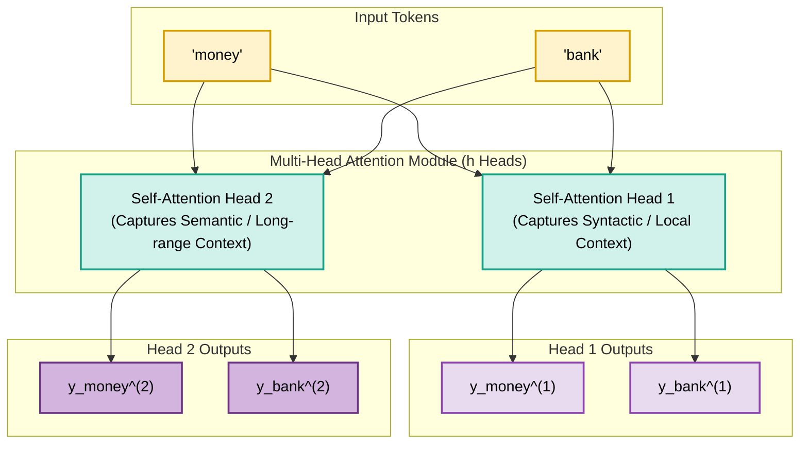
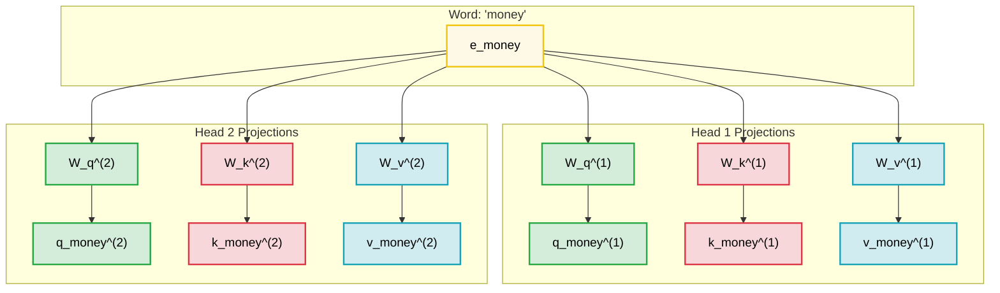
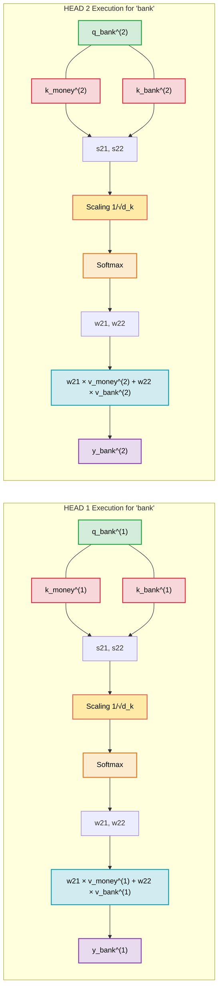
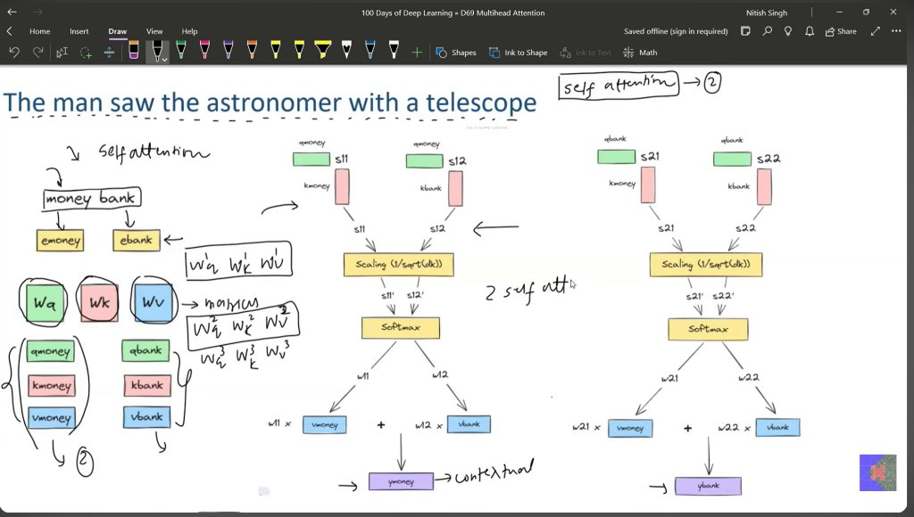
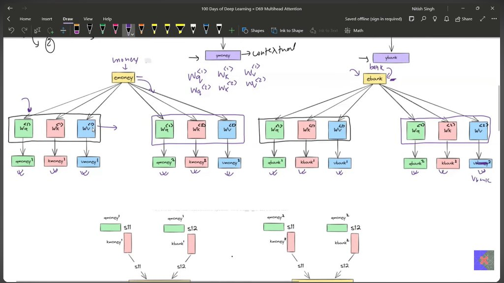
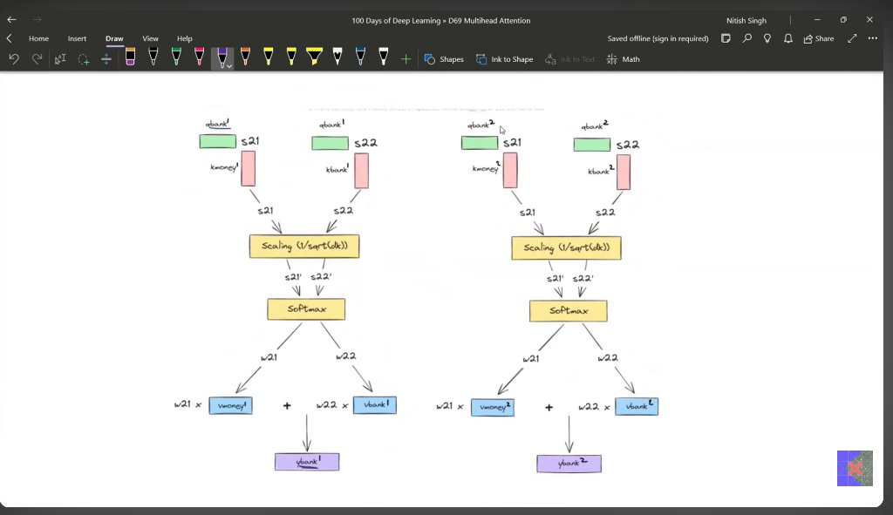
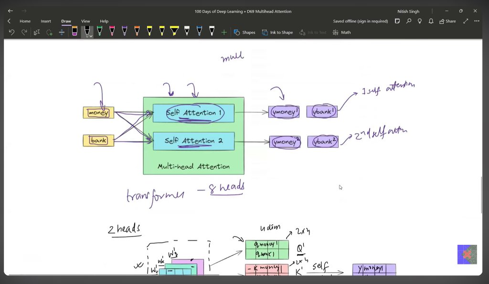
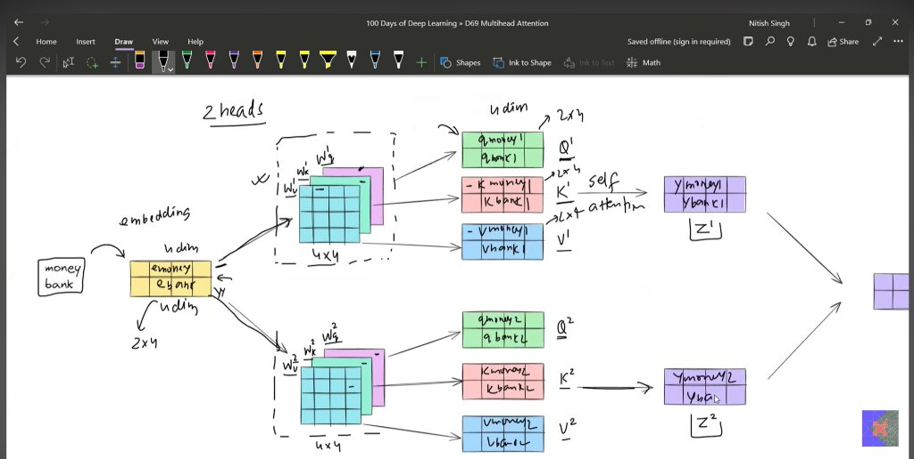

# Multi-Head Attention (MHA): Comprehensive Notes & Colorful Visual Guide

> **Based on Lecture:** 100 Days of Deep Learning » D69 Multihead Attention  
> **Example Sequence:** `"money bank"` & `"The man saw the astronomer with a telescope"`  
> **Related Document:** [Single-Head Self-Attention Notes](file:///d:/Jupyter_Executions/self_attention_notes.md)

---

## 1. Motivation: Why Do We Need Multiple Heads?

In single-head self-attention, each word computes a **single** weighted average over the entire sequence. However, words often participate in multiple syntactic, semantic, and contextual relationships at the same time.

### The Classic Linguistic Ambiguity:
> *"The man saw the astronomer with a telescope"*

```
Question: Who has the telescope?
           ┌─── Option A: The man used the telescope to see the astronomer.
           └─── Option B: The astronomer was holding/owning the telescope.
```

- A **single attention head** is forced to average these relationships together or pick one.
- **Multi-Head Attention** gives the model multiple "representation subspaces":
  - **Head 1:** Can track syntactic dependencies (e.g., subject-verb: who is doing the action).
  - **Head 2:** Can track prepositional attachments / instruments (e.g., *with a telescope*).
  - **Head 3:** Can track semantic context (e.g., *money* relates to *financial bank*).

---

## 2. High-Level Architecture: Multi-Head Container

Instead of performing self-attention once, we perform $h$ self-attentions in parallel.



> [!NOTE]
> In the original Transformer (*"Attention Is All You Need"*, Vaswani et al.), **$h = 8$ parallel attention heads** are used.

---

## 3. Independent Weight Matrices per Head

For $h = 2$ heads, instead of one set of $(W_q, W_k, W_v)$, the model learns **two independent sets** of projection matrices:
- **Head 1:** $W_q^{(1)}, W_k^{(1)}, W_v^{(1)}$
- **Head 2:** $W_q^{(2)}, W_k^{(2)}, W_v^{(2)}$

Each token embedding ($e_{money}$, $e_{bank}$) is projected into distinct Query, Key, and Value vectors for each head:



*(The identical branching projection occurs for $e_{bank}$, producing $q_{bank}^{(1)}, k_{bank}^{(1)}, v_{bank}^{(1)}$ and $q_{bank}^{(2)}, k_{bank}^{(2)}, v_{bank}^{(2)}$.)*

---

## 4. Parallel Attention Execution: Trace for Word `"bank"`

Both heads execute the scaled dot-product attention independently and simultaneously:



---

## 5. Matrix Form Walkthrough (2-Heads, $2 \times 4$ Dimension Example)

*(From Lecture Slide 5)*

In this concrete pedagogical example:
- Sequence: `"money bank"` $\implies 2$ tokens.
- Embedding dimension: $d_{model} = 4$.
- Number of heads: $h = 2$.
- Dimension of each head: $d_k = d_v = 4$.

```
========================================================================================================================
                                     MULTI-HEAD ATTENTION MATRIX WALKTHROUGH
========================================================================================================================

    [Input Embeddings X]
         (2 × 4)
    ┌───────────────────┐
    │  e_money (1 × 4)  │
    ├───────────────────┤
    │  e_bank  (1 × 4)  │
    └───────────────────┘
         │
         ├─────────────────────────────────────────┐
         │                                         │
         ▼                                         ▼
   [HEAD 1 BRANCH]                           [HEAD 2 BRANCH]
   Weights: Wq^(1), Wk^(1), Wv^(1)           Weights: Wq^(2), Wk^(2), Wv^(2)
   Each shape: (4 × 4)                       Each shape: (4 × 4)
         │                                         │
         ▼                                         ▼
   Q^(1), K^(1), V^(1)                       Q^(2), K^(2), V^(2)
   Each shape: (2 × 4)                       Each shape: (2 × 4)
         │                                         │
         ▼                                         ▼
   Self-Attention Block 1                    Self-Attention Block 2
   Softmax(Q^(1) K^(1)T / √dk) V^(1)         Softmax(Q^(2) K^(2)T / √dk) V^(2)
         │                                         │
         ▼                                         ▼
      Z^(1) (2 × 4)                             Z^(2) (2 × 4)
   ┌───────────────────┐                     ┌───────────────────┐
   │ y_money^(1) (1×4) │                     │ y_money^(2) (1×4) │
   ├───────────────────┤                     ├───────────────────┤
   │ y_bank^(1)  (1×4) │                     │ y_bank^(2)  (1×4) │
   └───────────────────┘                     └───────────────────┘
         │                                         │
         └────────────────────┬────────────────────┘
                              │
                              ▼
                 [Concatenate Both Heads]
                 Z_concat = [Z^(1), Z^(2)]
                          (2 × 8)
                 ┌─────────────────────────────┐
                 │ [y_money^(1) , y_money^(2)] │
                 ├─────────────────────────────┤
                 │ [y_bank^(1)  , y_bank^(2)]  │
                 └─────────────────────────────┘
                              │
                              │  Multiply by Output Weight Matrix W_o
                              │  Shape: (8 × 4)
                              ▼
                  [Final Contextual Output Z]
                            (2 × 4)
                 ┌─────────────────────────────┐
                 │      y_money (1 × 4)        │
                 ├─────────────────────────────┤
                 │      y_bank  (1 × 4)        │
                 └─────────────────────────────┘
========================================================================================================================
```

### Complete Mathematical Formulation:
$$\mathbf{MultiHead}(Q, K, V) = \mathbf{Concat}(\text{head}_1, \text{head}_2, \dots, \text{head}_h) W^O$$
$$\text{where } \text{head}_i = \text{Attention}(Q W_i^Q, K W_i^K, V W_i^V)$$

---

## 6. Standard Transformer Dimensions (Vaswani et al. 2017)

In production Transformers (like BERT-base and standard Transformer):
| Parameter | Symbol | Value |
|---|---|---|
| Model Hidden Dimension | $d_{model}$ | **512** |
| Number of Attention Heads | $h$ | **8** |
| Dimension per Head | $d_k = d_v = d_{model} / h$ | **$512 / 8 = 64$** |
| Concat Dimension before $W^O$ | $h \times d_v$ | **$8 \times 64 = 512$** |
| Output Projection Matrix $W^O$ | $W^O$ | **$512 \times 512$** |

> [!TIP] **Why does Multi-Head Attention not cost more compute?**  
> Because each head operates on projected subspace dimension $d_k = d_{model} / h = 64$, computing 8 heads of dimension 64 has essentially the exact same computational cost as running 1 single head of dimension 512, while providing 8 distinct representation perspectives!

---

## 7. Lecture Visual Reference Gallery

All lecture whiteboard drawings for Multi-Head Attention have been copied into your workspace:

| Topic | Visual Reference |
|---|---|
| **Linguistic Motivation & 2 Heads Overview** |  |
| **Independent Projections ($W_q, W_k, W_v$)** |  |
| **Parallel Execution on Word 'Bank'** |  |
| **Multi-Head Black Box Module (8 Heads)** |  |
| **Matrix Dimensions & Concat with $W_o$ (2×4)** |  |

---

## 8. Summary Comparison: Single-Head vs. Multi-Head

| Property | Single-Head Attention | Multi-Head Attention |
|---|---|---|
| **Projection Sets** | $1$ set $(W_q, W_k, W_v)$ | $h$ sets $(W_q^{(i)}, W_k^{(i)}, W_v^{(i)})$ |
| **Attention Distributions** | Single focus | $h$ simultaneous focal points |
| **Subspace Representation** | Blended single representation | Diverse perspectives (syntactic, semantic, coreference) |
| **Final Step** | Direct value weighting $y = \sum w_i v_i$ | $\text{Concat}(\text{head}_1, \dots, \text{head}_h) \times W^O$ |
