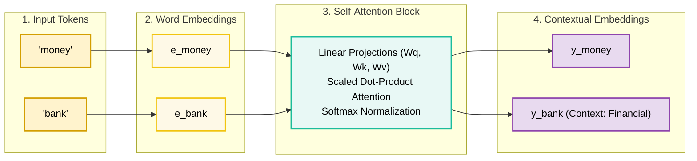
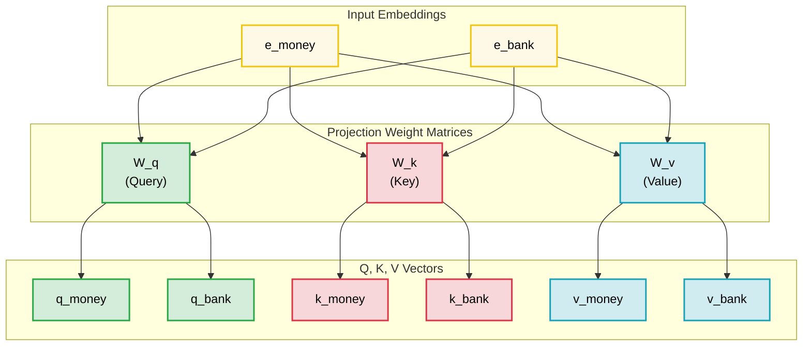
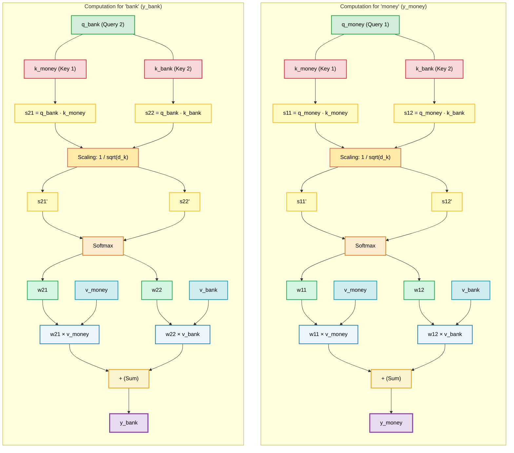
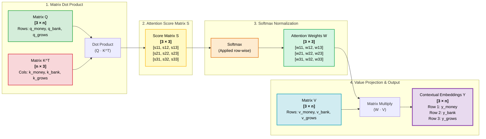
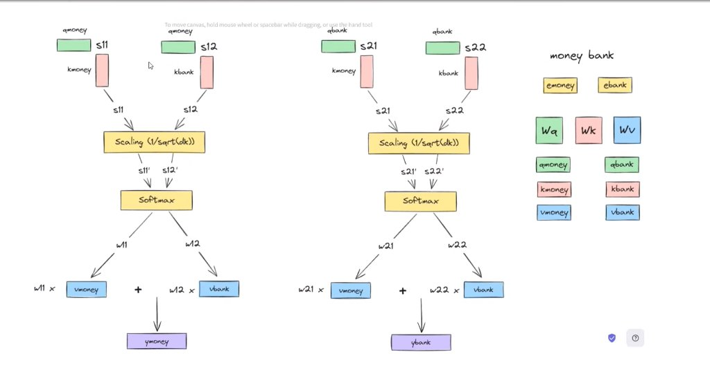
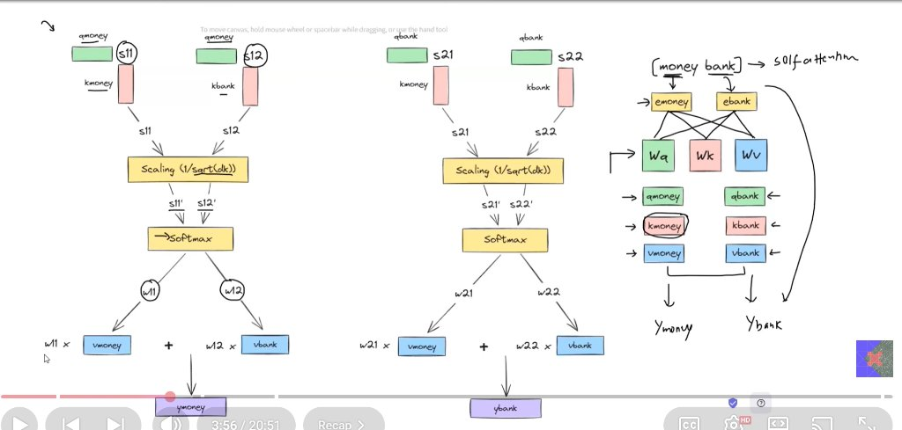
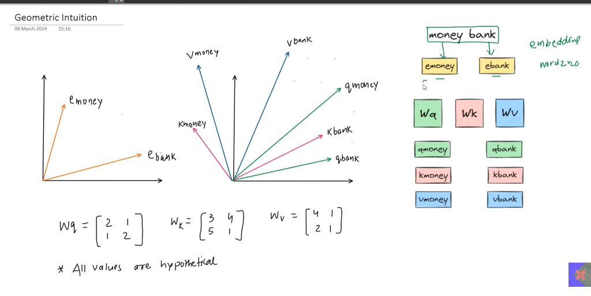
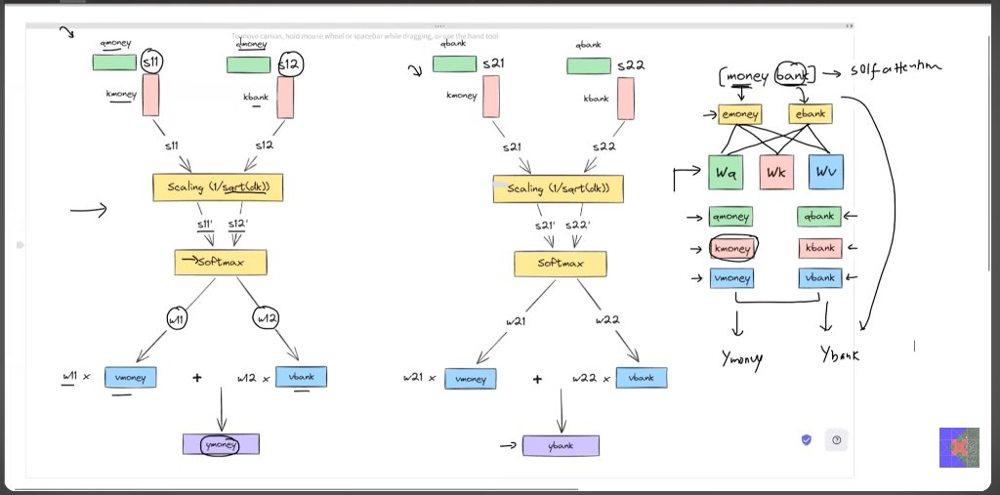
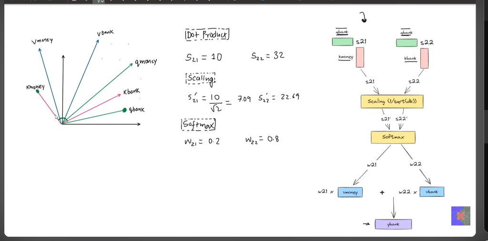
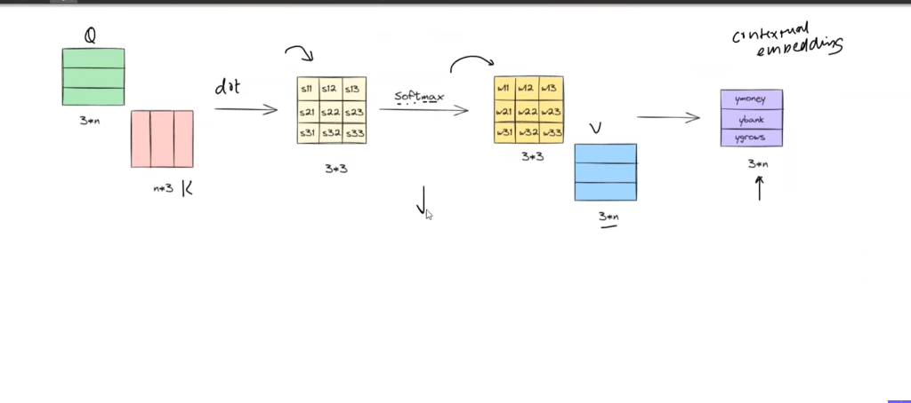

# Transformer Self-Attention: Comprehensive Notes & Visual Guide

> **Example Sequence:** `"money bank"`  
> **Topic:** Scaled Dot-Product Self-Attention Mechanism  
> **Status:** Active Working Notes (Modular & Extensible)

---

## 1. High-Level Concept & Intuition

In standard static word embeddings (like Word2Vec or GloVe), a word like **"bank"** receives a single static representation regardless of whether it refers to a *financial institution* or a *river bank*.

**Self-Attention** allows words in a sentence to interact with each other and compute dynamic, context-aware representations:
- Input: Static word embeddings $e_{money}, e_{bank}$
- Output: Contextual representations $y_{money}, y_{bank}$ (where $y_{bank}$ absorbs context from $e_{money}$, clarifying it is a financial bank).



---

## 2. Linear Projections: Queries, Keys, and Values

For each token embedding $e_i$, we project it into three distinct vector spaces using three learnable weight matrices:
- **$W_q$ (Query Weight Matrix):** What the current token is looking for / asking.
- **$W_k$ (Key Weight Matrix):** What information the token holds / offers.
- **$W_v$ (Value Weight Matrix):** The actual content / information payload.

### Projection Equations:
$$\begin{aligned}
q_{money} &= e_{money} W_q, & q_{bank} &= e_{bank} W_q \\
k_{money} &= e_{money} W_k, & k_{bank} &= e_{bank} W_k \\
v_{money} &= e_{money} W_v, & v_{bank} &= e_{bank} W_v
\end{aligned}$$



---

## 3. Pictographic Flowchart of the Self-Attention Architecture

Below is the complete computational diagram matching the chalkboard/whiteboard schematic for `"money bank"`.

### Visual Schematic (Mermaid)



---

### Pictographic Box-Drawing Representation (Matching Original Diagram Layout)

```
╔══════════════════════════════════════════════════════════════════════════════════════════════════════╗
║              WORD 1: 'money'                                            WORD 2: 'bank'               ║
╠══════════════════════════════════════════════════════════════════════════════════════════════════════╣
║                                                                                                      ║
║     [q_money]      [q_money]                                  [q_bank]       [q_bank]                ║
║    (horizontal)   (horizontal)                               (horizontal)   (horizontal)             ║
║         |              |                                          |              |                   ║
║         • (dot)        • (dot)                                    • (dot)        • (dot)             ║
║         |              |                                          |              |                   ║
║    ┌─────────┐    ┌─────────┐                                ┌─────────┐    ┌─────────┐              ║
║    │ k_money │    │ k_bank  │                                │ k_money │    │ k_bank  │              ║
║    └─────────┘    └─────────┘                                └─────────┘    └─────────┘              ║
║    (vertical)     (vertical)                                 (vertical)     (vertical)               ║
║         │              │                                          │              │                   ║
║        s11            s12                                        s21            s22                  ║
║         │              │                                          │              │                   ║
║         ▼              ▼                                          ▼              ▼                   ║
║    ┌─────────────────────────┐                               ┌─────────────────────────┐             ║
║    │   Scaling (1/√d_k)      │                               │   Scaling (1/√d_k)      │             ║
║    └─────────────────────────┘                               └─────────────────────────┘             ║
║         │              │                                          │              │                   ║
║        s11'           s12'                                       s21'           s22'                 ║
║         ▼              ▼                                          ▼              ▼                   ║
║    ┌─────────────────────────┐                               ┌─────────────────────────┐             ║
║    │        Softmax          │                               │        Softmax          │             ║
║    └─────────────────────────┘                               └─────────────────────────┘             ║
║         │              │                                          │              │                   ║
║        w11            w12                                        w21            w22                  ║
║         │              │                                          │              │                   ║
║         ▼              ▼                                          ▼              ▼                   ║
║     w11 × [v_money] + w12 × [v_bank]                          w21 × [v_money] + w22 × [v_bank]        ║
║                   │                                                         │                        ║
║                   ▼                                                         ▼                        ║
║               [y_money]                                                 [y_bank]                     ║
╚══════════════════════════════════════════════════════════════════════════════════════════════════════╝
```

---

## 4. Mathematical Steps & Walkthrough

### Step 1: Compute Raw Attention Scores (Dot Products)
Each query takes the dot product with all keys to determine affinity/similarity:
- **For `money`:**
  - $s_{11} = q_{money} \cdot k_{money}^T$
  - $s_{12} = q_{money} \cdot k_{bank}^T$
- **For `bank`:**
  - $s_{21} = q_{bank} \cdot k_{money}^T$
  - $s_{22} = q_{bank} \cdot k_{bank}^T$

### Step 2: Scaling
To prevent extremely large dot products in high-dimensional spaces (which would push softmax into regions with vanishing gradients), divide by $\sqrt{d_k}$:
$$s'_{ij} = \frac{s_{ij}}{\sqrt{d_k}}$$

### Step 3: Softmax (Attention Weights)
Normalize scores along each row to form probability distributions ($w_{i1} + w_{i2} = 1$):
$$w_{i1} = \frac{\exp(s'_{i1})}{\exp(s'_{i1}) + \exp(s'_{i2})}, \quad w_{i2} = \frac{\exp(s'_{i2})}{\exp(s'_{i1}) + \exp(s'_{i2})}$$

### Step 4: Weighted Sum of Values
Combine the value vectors according to the attention weights:
$$y_{money} = w_{11} \cdot v_{money} + w_{12} \cdot v_{bank}$$
$$y_{bank} = w_{21} \cdot v_{money} + w_{22} \cdot v_{bank}$$

---

## 5. Concrete Numerical Example & Geometric Intuition

*(From Lecture Notes Slide 3 & Slide 5)*

### Hypothetical Weight Matrices
Assuming a 2-dimensional representation space ($d_k = 2$):
$$W_q = \begin{bmatrix} 2 & 1 \\ 1 & 2 \end{bmatrix}, \quad W_k = \begin{bmatrix} 3 & 4 \\ 5 & 1 \end{bmatrix}, \quad W_v = \begin{bmatrix} 4 & 1 \\ 2 & 1 \end{bmatrix}$$

### Step-by-Step Calculation for `"bank"`:
1. **Dot Products:**
   - $s_{21} = q_{bank} \cdot k_{money} = 10$
   - $s_{22} = q_{bank} \cdot k_{bank} = 32$
2. **Scaling ($d_k = 2 \implies \sqrt{d_k} = \sqrt{2} \approx 1.414$):**
   - $s'_{21} = \frac{10}{\sqrt{2}} \approx 7.07 \quad (\text{annotated as } 7.09)$
   - $s'_{22} = \frac{32}{\sqrt{2}} \approx 22.63 \quad (\text{annotated as } 22.69)$
3. **Softmax Output (Attention Weights):**
   - $w_{21} = 0.2$ (Weight given to `money`)
   - $w_{22} = 0.8$ (Weight given to `bank` itself)
4. **Final Contextual Embedding:**
   $$y_{bank} = 0.2 \cdot v_{money} + 0.8 \cdot v_{bank}$$

### Geometric Intuition
- In 2D vector space, **dot product** reflects both magnitude and directional alignment ($\vec{a} \cdot \vec{b} = |\vec{a}| |\vec{b}| \cos\theta$).
- The smaller the angle $\theta$ between Query and Key, the higher the affinity.
- Because $q_{bank}$ aligns closely with $k_{bank}$ (and also has affinity with $k_{money}$), $y_{bank}$ becomes a mixture of its own value $v_{bank}$ and the contextual value $v_{money}$.

---

## 6. Matrix Form: Vectorized Self-Attention (Sequence: `"money bank grows"`)

In practice, modern deep learning frameworks (PyTorch, JAX, TensorFlow) do not compute attention token-by-token using loops. Instead, all operations are parallelized as high-throughput matrix multiplications on GPUs/TPUs.

Here, the sequence is extended to **3 tokens** ($T = 3$):
- **Token 1:** `"money"`
- **Token 2:** `"bank"`
- **Token 3:** `"grows"`

Let $n$ denote the hidden/embedding dimension ($d_k = d_v = n$).

```
      Q (3 × n)            K (n × 3)               Scores S (3 × 3)                 Weights W (3 × 3)                 V (3 × n)           Contextual Y (3 × n)
  ┌───────────────┐     ┌───┬───┬───┐          ┌─────┬─────┬─────┐              ┌─────┬─────┬─────┐               ┌───────────────┐        ┌───────────────┐
  │    q_money    │     │   │   │   │   dot    │ s11 │ s12 │ s13 │   Softmax    │ w11 │ w12 │ w13 │               │    v_money    │        │    y_money    │
  ├───────────────┤  •  │k_m│k_b│k_g│  ────>   ├─────┼─────┼─────┤  ────────>   ├─────┼─────┼─────┤   •    ────>  ├───────────────┤  ===>  ├───────────────┤
  │    q_bank     │     │   │   │   │          │ s21 │ s22 │ s23 │   (row-wise) │ w21 │ w22 │ w23 │               │    v_bank     │        │    y_bank     │
  ├───────────────┤     │   │   │   │          ├─────┼─────┼─────┤              ├─────┼─────┼─────┤   ┌───────────┼───────────────┤        ├───────────────┤
  │    q_grows    │     └───┴───┴───┘          │ s31 │ s32 │ s33 │              │ w31 │ w32 │ w33 │   │           │    v_grows    │        │    y_grows    │
  └───────────────┘       (Transposed)         └─────┴─────┴─────┘              └─────┴─────┴─────┘   │           └───────────────┘        └───────────────┘
                                                                                                      │
                                                                                                (3 × 3) × (3 × n)  ───>  (3 × n)
```

### Visual Pipeline (Mermaid)



### Dimensional Breakdown:
1. **Query Matrix $Q \in \mathbb{R}^{3 \times n}$:**
   - Stack of query row vectors: $\begin{bmatrix} q_{money} \\ q_{bank} \\ q_{grows} \end{bmatrix}$.
2. **Key Matrix $K^T \in \mathbb{R}^{n \times 3}$:**
   - Transposed keys arranged as columns: $\begin{bmatrix} k_{money}^T & k_{bank}^T & k_{grows}^T \end{bmatrix}$.
3. **Score Matrix $S = Q K^T \in \mathbb{R}^{3 \times 3}$:**
   - Each element $S_{ij} = q_i \cdot k_j^T$ represents the unnormalized affinity between token $i$ and token $j$.
4. **Attention Weights $W = \text{Softmax}\left(\frac{QK^T}{\sqrt{d_k}}\right) \in \mathbb{R}^{3 \times 3}$:**
   - Row-wise softmax ensures every row sums to 1 ($\sum_{j=1}^3 w_{ij} = 1$).
   - Row 1: Attention distribution for `"money"`.
   - Row 2: Attention distribution for `"bank"`.
   - Row 3: Attention distribution for `"grows"`.
5. **Value Matrix $V \in \mathbb{R}^{3 \times n}$:**
   - Stack of value row vectors: $\begin{bmatrix} v_{money} \\ v_{bank} \\ v_{grows} \end{bmatrix}$.
6. **Output Matrix $Y = W V \in \mathbb{R}^{3 \times n}$:**
   - Each row is a convex combination of value vectors:
     $$\begin{aligned}
     y_{money} &= w_{11} v_{money} + w_{12} v_{bank} + w_{13} v_{grows} \\
     y_{bank}  &= w_{21} v_{money} + w_{22} v_{bank} + w_{23} v_{grows} \\
     y_{grows} &= w_{31} v_{money} + w_{32} v_{bank} + w_{33} v_{grows}
     \end{aligned}$$

### The Universal Transformer Attention Formula:
$$\mathbf{Attention}(Q, K, V) = \text{softmax}\left(\frac{Q K^T}{\sqrt{d_k}}\right) V$$

---

## 7. Lecture Visual Reference Gallery

| Topic | Diagram Reference |
|---|---|
| **Architecture Flowchart** |  |
| **Annotated Pipeline** |  |
| **Geometric Intuition & Matrices** |  |
| **Focus on 'Bank' Output** |  |
| **Numerical Walkthrough** |  |
| **Matrix Formulation (3×n)** |  |

---

## 8. Upcoming Sections & Placeholders for Updates

As we proceed, you can ask to insert:
- [x] **Matrix Form Formulation:** Vectorized $\text{Attention}(Q, K, V) = \text{softmax}\left(\frac{QK^T}{\sqrt{d_k}}\right)V$ with dimensions $3 \times n$, $3 \times 3$, and $3 \times n$.
- [ ] **Multi-Head Attention (MHA):** Splitting $Q, K, V$ into multiple heads $h_1, h_2, \dots, h_m$ and concatenating with $W_o$.
- [ ] **Positional Encodings:** Why Transformers lack recurrence/order and how sinusoidal or learned embeddings add position information ($e_i + p_i$).
- [ ] **Masked Self-Attention (Causal Masking):** Setting upper-triangular scores to $-\infty$ so tokens cannot look into the future.
- [ ] **LayerNorm & Residual Connections:** Skip connections $x + \text{Sublayer}(x)$ and Pre-LN / Post-LN mechanisms.
